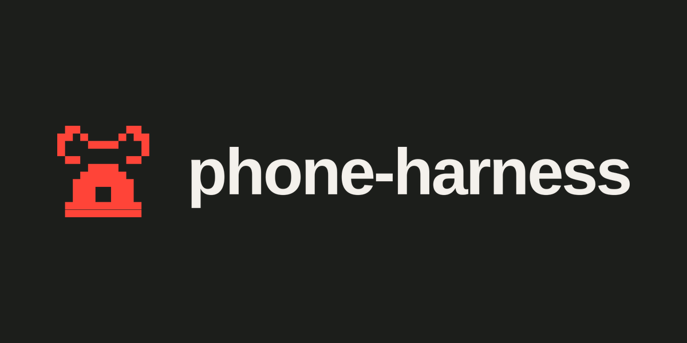

# phone-harness for Hermes Agent



A [Hermes Agent](https://github.com/NousResearch/hermes-agent) plugin that lets
Hermes drive a real phone with one tool, `phone_exec`. The model writes a short
Python script with the phone-harness helpers pre-imported, and the plugin runs
it on the phone and returns what it printed.

```text
phone_exec(code='''
ensure_device()
open_app("Weather")
wait_stable()
print([o["text"] for o in screen()][:12])
''')
```

When the installed `phone_harness` package contains `SKILL.md`, the plugin
registers that file as the skill `phone-harness:phone-harness`, and passes
Hermes the description and frontmatter from the file (Hermes does not re-read
them for the skill list). If the package does not ship `SKILL.md`, no skill is
registered. The agent reads the helpers from that skill.

## Install

```bash
hermes plugins install ShawnPana/phone-harness/integrations/hermes
```

Hermes installs the `phone-harness` package into its own environment and asks
whether to enable the plugin. Tools load per session, so start a new chat.
Restart the Hermes desktop app after installing or updating the plugin.
Each script runs as `python -m phone_harness.run` on Hermes's interpreter: the
copy Hermes installed, kept apart from a `phone-harness` command on `PATH`.

phone-harness chooses the phone (an attached cloud phone, otherwise its
default). To force the phone on this machine, export `PHONE_HARNESS_PLATFORM`
as `ios` or `android` in the environment Hermes runs in. iPhone control needs
Accessibility and Screen Recording for the app that runs Hermes (the Hermes
desktop app, or your terminal for `hermes` in a shell). Android needs adb; a
cloud phone needs `phone-harness cloud login`. [install.md](../../install.md)
covers each.

## Settings

- Every `phone_exec` call asks before it runs. See [Approvals](#approvals).
- Classifier auto-run is off unless you opt in. With it on, a script the
  classifier judges to be phone-only skips the prompt. The classifier is a
  heuristic and can be bypassed, so a script may still reach this computer.
  Leave it off unless you accept that.
  - Plugin setting `classifier_auto_run` (boolean, default false).
  - Or export `PHONE_HARNESS_CLASSIFIER_AUTO_RUN=1` in the environment Hermes
    runs in. When that variable is set, it wins over the plugin setting.
- Telemetry is off for Hermes runs unless you opt in with `phone-harness config set telemetry true`.
- `PHONE_HARNESS_PLATFORM`, when you have exported it, is passed through.
- The agent workspace is one folder, `agent-workspace`, in Hermes's plugin
  data directory. If `PH_AGENT_WORKSPACE` is already set, that path is used
  instead. Each script receives it as `PH_AGENT_WORKSPACE`. If
  `agent_helpers.py` is missing, the packaged default is copied in; a file
  that is already there is left as it is.

## How it works

1. The model calls `phone_exec(code, timeout_s=300)`.
2. A `pre_tool_call` hook asks you to approve every script before it runs.
   Hermes shows a short description of the script. One answer for the session,
   or always, covers later calls. With classifier auto-run opted in, a script
   that only drives the phone runs without asking, and anything else still asks.
3. Subagents in this process take turns on the phone, via an in-process lock.
   After 120 s the tool reports the phone as busy.
4. The plugin pipes the script on stdin to the phone-harness Hermes installed,
   with `PH_AGENT_WORKSPACE` and `PH_CLIENT=hermes`. It does not set a platform.
   Telemetry is off for Hermes runs unless you opt in with `phone-harness config set telemetry true`.
5. The result is what the script printed, plus the exit code and the tail of
   stderr. `screenshot()` prints the path it saved. The last absolute PNG,
   JPEG, or WebP path in that output that exists and was written during the
   call is attached to the tool result when the model can view images. A
   large image is reduced first. If the model cannot view images, or
   attaching fails, the result stays plain text and the path is in
   `screenshots` (open it with `vision_analyze`). A script past its timeout
   is killed with everything it started.

## Approvals

Every `phone_exec` call asks you before it runs. Hermes shows a short
description of the script. Allow it once, for the session, or always; one
session or always answer covers later calls. If nobody can answer (a scheduled
job, or a chat with no one there), the script does not run.

Classifier auto-run is off unless you opt in (see [Settings](#settings)). With
it on, scripts that only use the phone helpers run immediately. The check is a
heuristic and can be bypassed: a script can still reach this computer. Leave
it off unless you accept that.

While auto-run is on, a script still asks when it imports anything other than
the phone helpers, reads or writes files, runs or evaluates code, uses Python
internals, runs an adb shell command, or calls `send("raw", ...)`. What to do
on the phone itself — sending, posting, buying, deleting, changing settings —
is still the skill's consent rule: the agent asks you before those.

## What it touches

- Runs model-written Python locally through the phone-harness Hermes installed.
- Taps and types into your real phone, with your apps and accounts.
- Screenshots are PNG files in the system temp folder.
- A cloud phone streams its screen to Phone Harness Cloud and uses phone-harness's own cloud sign-in.
  A cloud Android bills by the minute; a cloud iPhone does not.
- Hermes adds the plugin's toolset to every platform that has a saved tool
  selection, messaging platforms included. Turn it off there with
  `hermes tools` unless you want people who can message your bot to drive your
  phone.

## Limits

- A screenshot saved during the call is attached when the model can view
  images. Otherwise the path is in the text result for `vision_analyze`.
- No password-vault integration: the agent never types passwords, PINs or 2FA
  codes. Hand the phone back to the user for those.
- `back()` is Android-only; on an iPhone the agent taps the app's back arrow.
